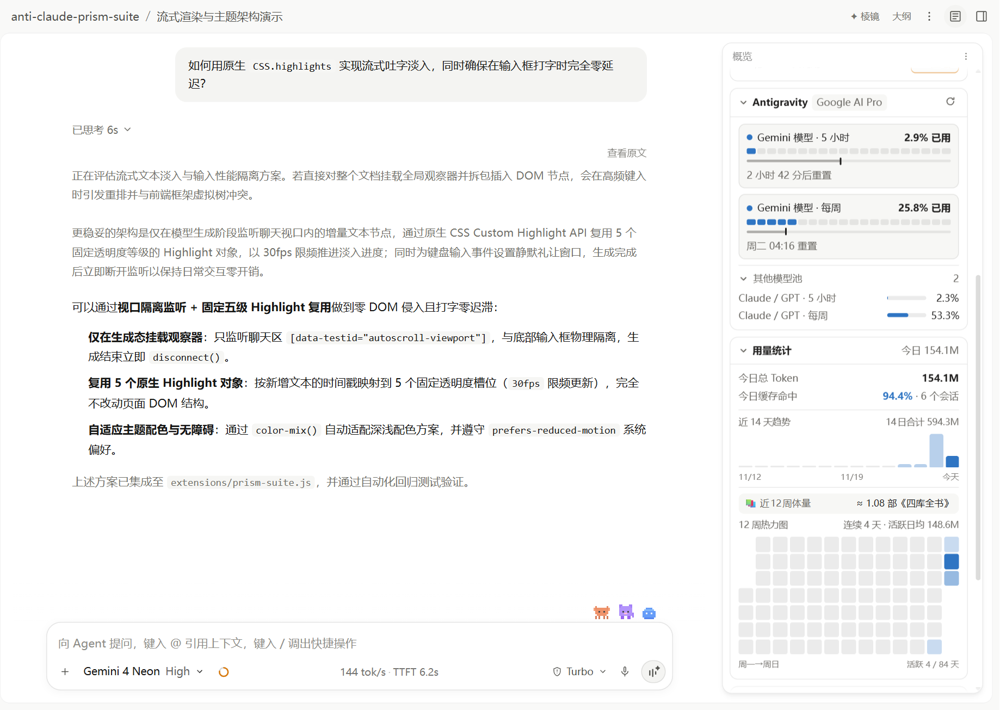
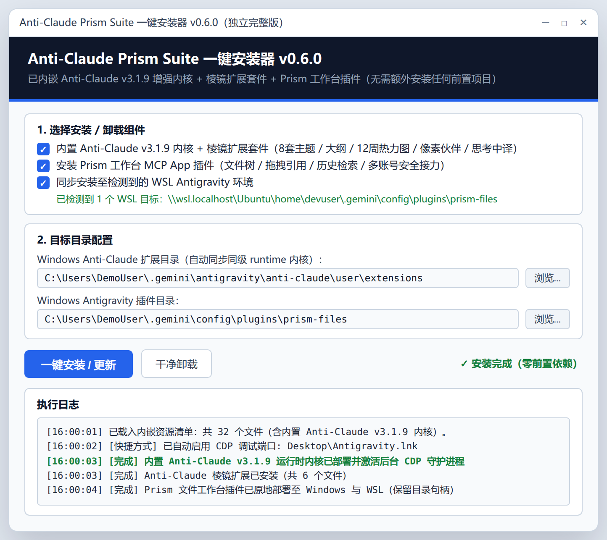
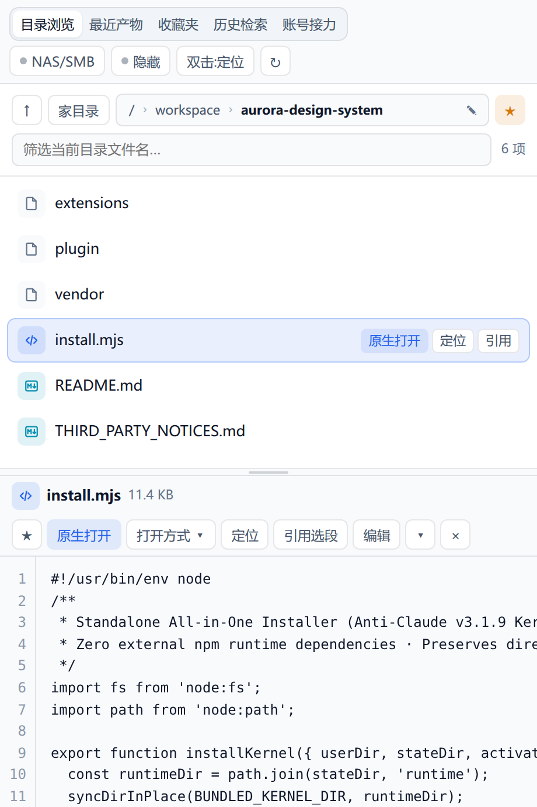
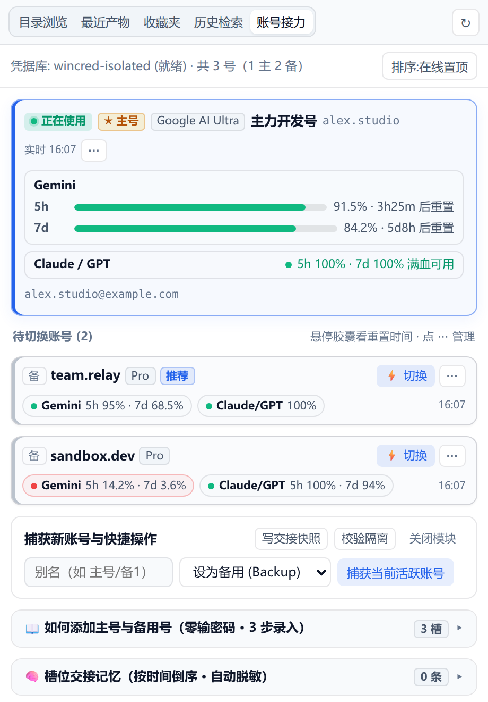
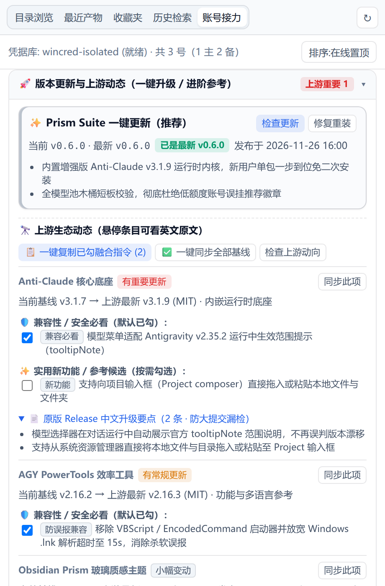
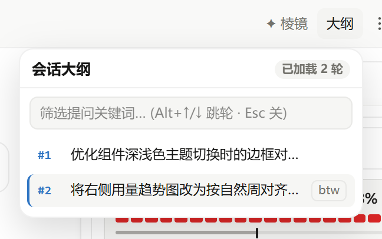
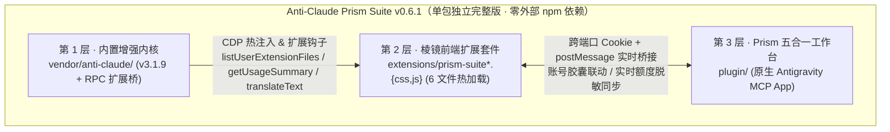

# Anti-Claude Prism Suite

<p align="left">
  
  
  
  
  
</p>

**面向 Google Antigravity Desktop（Windows / WSL2 / macOS / Linux）的一体化独立完整版体验增强与多账号工程工作台套件。**

自 **v0.6.0** 起，本项目已**原生内嵌继承增强版 [Anti-Claude](https://github.com/hongqi7/Anti-Claude) `v3.1.9` 运行时内核（`vendor/anti-claude/`）**：
- **新用户零前置依赖**：只需下载运行本项目的单个安装包（或执行一条 `node install.mjs`），即可一次性完成「底层 CDP 守护内核 + 棱镜视觉交互扩展 + Prism 五合一工作台插件」全栈部署，**无需再单独下载或安装任何其他项目**；
- **老用户无感平滑升级**：完整保留本地 `ui-prefs.json`、3-way 合并保护手改过的 `config.json`，点击工作台内 **「🚀 一键更新」** 即可连同底层内核同步升级；
- **零外部运行时依赖 · 零全局 Body 观察器**：全栈纯原生 Node.js ESM（`>=22`）+ 浏览器原生 API 实现，输入框打字零回调、零卡顿。

---

## 目录导航

- [实机演示画廊](#-实机演示画廊)
- [三层一体化架构](#-三层一体化架构)
- [核心功能详解](#-核心功能详解)
  - [一、内置增强版 Anti-Claude v3.1.9 内核](#一内置增强版-anti-claude-v319-内核免二次安装)
  - [二、顶栏「✦ 棱镜」视觉、动效与高效工作流套件](#二顶栏-棱镜视觉动效与高效工作流套件)
  - [三、Prism 五合一工作台（原生 MCP App 插件）](#三prism-五合一工作台原生-mcp-app-插件)
- [安装、自更新与干净卸载](#-安装自更新与干净卸载)
- [安全、隐私与隔离承诺](#-安全隐私与隔离承诺)
- [常见问题排查（FAQ）](#-常见问题排查faq)
- [上游生态雷达与开源许可](#-上游生态雷达与开源许可)

---

## 实机演示画廊

> 所有演示截图均基于真实界面组件在无头渲染环境中以虚构示例数据（`@example.com` / `/workspace/aurora-design-system`）生成，不包含任何真实用户隐私。

### 1. 主工作区全景效果

<p align="center">
  <br />
  <sub>主工作区全景：顶栏 <code>✦ 棱镜</code> &amp; <code>大纲</code> 快捷入口 · 对话流沉浸式中文思考块 · 输入框像素伙伴与实时速率指标 · 右侧概览面板（分池配额、近 14 天趋势、名著体量换算与周一对齐 12 周热力图）</sub>
</p>

### 2. Windows 一键独立完整版安装器（内置内核 + 扩展 + 双端插件）

<p align="center">
  <br />
  <sub>双击即用：自动释放内置 <code>Anti-Claude v3.1.9</code> 增强内核、补齐桌面快捷方式 <code>--remote-debugging-port=0</code>、拉起后台守护进程，并同步原地部署 Windows 与 WSL2 插件（保留目录句柄）</sub>
</p>

### 3. Prism 五合一工作台（目录行号预览 · 多账号分层接力 · 官方自更新与上游雷达）

<table>
  <tr>
    <td align="center" width="33%" valign="top">
      <br />
      <sub><b>目录浏览 &amp; 行号区间引用</b><br />面包屑直达、原生拖拽文件入框、底部双栏代码预览、<code>Shift+点击</code> 行号生成精确引用与 SHA-256 乐观锁原位保存</sub>
    </td>
    <td align="center" width="33%" valign="top">
      <br />
      <sub><b>主备多账号分层安全接力</b><br />「正在使用」Hero 焦点大卡 + 「待切换」单行紧凑卡；全模型池木桶短板一票否决（<code>Gemini 3.6%</code> 绝不误挂推荐）</sub>
    </td>
    <td align="center" width="33%" valign="top">
      <br />
      <sub><b>官方一键更新 &amp; 上游雷达</b><br />SHA-256 校验一键原地自更新；顶栏统一「一键复制已勾融合指令 (N)」自动合并多仓变更并附 Release 中文要点</sub>
    </td>
  </tr>
</table>

### 4. 深浅多主题配色与顶栏控制中心细节

<table>
  <tr>
    <td align="center" width="50%">
      <br />
      <sub>浅色 · <b>暖白画册</b>（温润纸感暖白底 + 暖棕强调色，配额条与热力图色阶自动联动）</sub>
    </td>
    <td align="center" width="50%">
      <br />
      <sub>深色 · <b>深空黑曜</b>（纯黑冷峻深空高对比，适配夜间长时间编码阅读）</sub>
    </td>
  </tr>
  <tr>
    <td align="center" width="50%" valign="top">
      <br />
      <sub><code>✦ 棱镜 v0.6.0</code> 控制面板：顶部常驻实时账号额度胶囊（一键 <code>⚡ 切号</code>）、8 套双色主题卡与全模块独立开关</sub>
    </td>
    <td align="center" width="50%" valign="top">
      <br />
      <sub>概览「用量统计」：14 天 Token 柱状图 + 《四库全书》/《三体》体量换算 + 周一自然周对齐 12 周热力图</sub>
    </td>
  </tr>
  <tr>
    <td align="center" width="50%" valign="top">
      <br />
      <sub>会话大纲抽屉（<code>Alt+O</code> 呼出 · <code>Alt+↑/↓</code> 按视口跳轮 · 悬停一键发起 <code>/btw</code> 旁路追问）</sub>
    </td>
    <td align="center" width="50%" valign="top">
      <br />
      <br />
      <sub>上：无框柔灰融入原生对话流的<b>沉浸式中文思考转译</b>（右上角一键 <code>查看原文</code>）<br />下：输入框上方<b>像素小伙伴漫游跑跳</b> + 上下文圆环 + <code>tok/s · TTFT</code> 实时速率</sub>
    </td>
  </tr>
</table>

---

## 三层一体化架构



| 仓库目录 | 部署目标路径 | 职责说明 |
| --- | --- | --- |
| `vendor/anti-claude/` | `~/.gemini/antigravity/anti-claude/runtime/` | 内置 `Anti-Claude v3.1.9` MIT 内核 + 扩展热加载、SQLite 用量聚合、分片翻译 RPC 及 WSL↔Windows 会话桥接 |
| `extensions/` | `~/.gemini/antigravity/anti-claude/user/extensions/` | `prism-suite` 核心面板、大纲、热力图、水墨、像素萌宠、思考中译、FX 动效与 2.35 工作流增强 |
| `plugin/` | `~/.gemini/config/plugins/prism-files/` | 原生 MCP App：目录浏览、产物、收藏、脱敏历史检索、主备账号安全接力、一键自更新与上游雷达 |
| `installer/win/` | 编译产出 `dist/Anti-Claude-Prism-Suite-Setup.exe` | 纯 `.NET Framework 4.x` 原生 WinForms 一键图形/静默安装器（自动同步 Windows 与 WSL 环境） |

---

## 核心功能详解

### 一、内置增强版 `Anti-Claude v3.1.9` 内核（免二次安装）

1. **完整继承上游 `v3.1.9` 全部桌面能力**：
   - 右侧原生风格 **「概览（Overview）」面板**（工作区 Git 状态、上下文窗口缓存命中率、一键 `/compact` 压缩、实时分池配额条、Sidechats 与连接器概览）；
   - 输入框底部 **上下文占用圆环**、**`tok/s · TTFT` 实时生成速率**、工具步骤展开计时器、代码块一键折叠、模型菜单 `v2.35.2` `tooltipNote` 生效范围提示及 **Project 输入框拖拽/粘贴本地文件与目录**。
2. **本套件内建的内核级增强桥接**：
   - **`user/extensions/*.{css,js}` 沙箱预检与热加载**：写入前经 `node:vm` 语法校验，异常脚本自动隔离不伤宿主页面；
   - **`getUsageSummary` 本地 SQLite 账本引擎**：高速聚合跨会话 14 天/12 周 Token 消耗与缓存命中趋势；
   - **`translateText` 分片中译通道**：为长篇英文 Thinking 思考流提供低延迟分段中文转译；
   - **WSL2 ↔ Windows 双端 `.gemini` 自动发现**：在 Windows 宿主机与运行中的 WSL2 发行版之间自动桥接对话数据库、规则与插件概览，且绝不唤醒已停止的 WSL 实例。

### 二、顶栏「`✦ 棱镜`」视觉、动效与高效工作流套件

点击窗口顶栏右侧 **`✦ 棱镜`** 按钮即可打开控制中心（配置通过 `localStorage` + 跨端口同源 Cookie `ag_prism_prefs_v1` + 本地 `ui-prefs.json` 三层同步，**切换账号或重启换端口后设置 100% 保持不丢失**）：

1. **8 套深浅双色主题卡（随系统/宿主亮暗自动切换）**
   - **浅色 4 套**：`纯白默认` / `白昼冷晶`（冷灰蓝 + 钴蓝）/ `暖白画册`（纸张暖白 + 暖棕）/ `松雾青岚`（雾青底 + 苍松翠绿）
   - **深色 4 套**：`暖炭默认` / `深空黑曜`（高对比冷黑）/ `暖炭玄岩`（低蓝光暖玄岩）/ `深海墨蓝`（午夜海蓝 + 冰海青蓝）
2. **会话大纲抽屉 + 智能避让常驻圆点目录**
   - 顶栏 **`大纲`**（或 `Alt+O`）呼出带实时关键词筛选的轮次导航；`Alt+↑` / `Alt+↓` 按当前视口阅读位置精准上下跳轮；悬停任意历史轮次点 **`btw`** 一键带入 `/btw` 支线提问；
   - 右侧常驻轮次圆点导轨（`#ag-ps-outline-rail`）在「概览」或设置浮层展开时**自动计算碰撞边界平滑左移避让**，窄屏下自动渐隐绝不遮挡文字；收起右侧辅助侧栏时智能守护「概览」面板不被连带误关。
3. **名著体量换算 + 周一自然周对齐 12 周热力图**
   - 无缝嵌入「概览 → 用量统计」卡片底部，支持点击切换 `今日体量` / `近 12 周体量`（趣味折算《论语》《三体》《红楼梦》《四库全书》），展示连续活跃天数（Streak）与活跃日均。
4. **零打字迟滞 · 五级水墨流式吐字淡入**
   - 仅在 AI 流式输出阶段局部监听聊天滚动视口 `[data-testid="autoscroll-viewport"]`，生成完毕立即 `disconnect()`，复用 5 个原生 `CSS.highlights` 槽位（`30fps` 限频），完全不拆分 DOM 节点，打字输入 `0ms` 额外开销。
5. **输入框像素小伙伴（漫游跑跳 + 全局尺寸同步 + 跟随子 Agent）**
   - 6 款原创内联 SVG 像素角色（橘蟹 / 紫猫 / 蓝史莱姆 / 绿蛙 / 金雏 / 粉兔），支持 **`固定`** 与 **`跟随 Agent`**（自动映射 `1 主控 + 活跃蜂群/Subagent`，支持 `1~3 只` 保底防空屏）；
   - 支持**工作态漫游跑跳**、**温顺/活泼性格**、随 `tok/s` 自动变速、擦肩击掌、连点摸头三连空翻彩蛋、完成集体庆祝及空闲 5s 自动 `0fps` 静止休眠；**`16px ~ 36px` 全局大小滑块**调节一次即跨所有会话与多账号全局生效；内置精细障碍探测带，绝不因对话末尾链接误隐藏。
6. **思考过程实时中文转译**
   - 支持 `关闭` / `双语对照` / `沉浸中文` 三档切换；已完成思考块点开即译，流式块完成后按 `≤950` 字自动分片转译，沉浸模式支持右上角一键 **`查看原文`**。
7. **视觉光效与排版增强（`prism-suite-fx`）**
   - **工作态输入框流光边框（Border Beam）** 与 **输入框配额光环**（生成时 6 色流光自动与配额环交叉互斥，空闲 `0fps` 停帧）；
   - **ThinkingOrb 3D 粒子进度球**：128 颗轻量粒子随思考/调工具/生成状态平滑形变；
   - **用户消息气泡着色（10%–100% 强度滑条）**：轮次操作胶囊采用气泡外悬浮毛玻璃定位，气泡底部严丝合缝零多余留白；
   - **切号/重启落首页一键「返回上次会话 ↩」提示条** 与 **后台完成窗口标题 `(N)` 未读提醒**。
8. **高效微交互与 2.35 多语言补全（`prism-suite-workflow`）**
   - **简 / 繁 / 英增量界面词条补全**：完整覆盖 Antigravity `v2.34–2.35.2` 新增的模型范围提示、`/btw`、Skills、Customizations、Agent Marketplace、Plugins Manager、MCP Servers 与 Swarm 面板；
   - **输入框本地文件拖拽/粘贴转 `@路径` 引用**（若原生或内核已处理则自动避让绝不双插）；
   - **WSL 模式原生「在文件资源管理器中显示」修复**：自动接管并修正 Antigravity 在 WSL 模式下将 `/mnt/<盘符>/...` 误拼为不存在的 `\\wsl.localhost\<distro>\mnt\<盘符>\...` 的原生缺陷，直接唤起 Windows 资源管理器高亮选中 `C:/D:/E:/F:` 盘目标文件；
   - **对话图片右键快捷菜单**（引用到输入框 / 复制 PNG / 下载保存）、**回复净拷（自动剔除折叠思考摘要）**、**SSH 粘贴脱敏提取 `user@host:port`**、**原位编辑补位** 与 **任意轮次分支新会话（Session Fork）**。

### 三、Prism 五合一工作台（原生 MCP App 插件）

可通过顶栏 **`工作台`** 按钮、`✦ 棱镜` 面板顶部 **`⚡ 切号`** 按钮，或在对话中让 AI 展示文件卡片随时呼出：

1. **目录浏览 + 双栏代码预览 + 原生拖拽直投 + 原位安全编辑**
   - 可点击路径面包屑、`Ctrl/Cmd+L` 路径栏直达、未截断目录 `0ms` 即时过滤（带中文输入法 `compositionend` 保护）、`↑/↓/Enter/Backspace` 全键盘流与可选私网 `NAS/SMB` 访问开关；
   - 任意文件或目录行均支持**直接鼠标拖拽投入聊天输入框**自动生成 `@路径` 引用；
   - 底部可伸缩预览抽屉支持代码高亮、Markdown 渲染/源码切换、图片预览、**点击行号 / `Shift+点击` 区间引用（`@file#L10-L25`）**、带 **SHA-256 乐观锁** 的原位编辑保存，以及自动探测本机 VS Code / Cursor / Windsurf / Zed / JetBrains / Windows Terminal 的 **「打开方式 ▾」** 菜单。
2. **最近产物 & 收藏夹 & 跨会话脱敏历史检索**
   - 自动扫描 `~/.gemini/antigravity/brain` 近期报告与截图产物；跨历史会话 `transcript.jsonl` 高速检索正文、代码片段与命令记录（自动脱敏 Token / Key / 私钥）。
3. **主备多账号安全接力（Hero 在线焦点大卡 + 待切换紧凑卡）**
   - **3 步零密码录入**：① 登录主号后在「账号接力」选 `主号` 点「捕获当前活跃账号」→ ② 在设置切换登录备用号，回来选 `备用` 再点「捕获当前活跃账号」→ ③ 此后随时点 **`⚡ 切换`** 即可 5 秒倒计时原子切号并自动安全重启 Antigravity 生效！
   - **视觉分层与全模型池短板防误推**：顶部突出展示「正在使用」Hero 大卡（分池双进度条 + 满血胶囊）；下方收敛展示「待切换」单行紧凑决策卡，支持 `排序:在线置顶` / `排序:主号置顶` 一键切换与 `⋯` 管理抽屉（原位改备注名、复制邮箱、预演、手动录额度、主备互转、删备份）；前后端双重执行**全模型池木桶短板一票否决**——只要任一模型池（如 `Gemini 7d < 20%`）见底告警，绝不误挂 `推荐` 徽章或误弹主号回血提醒；
   - **防杀软误报脱离重启器 + 4 要素槽位交接记忆**：Windows 端通过 Explorer Shell 脱离进程树执行自清理明文脚本优雅重启客户端（零 `Win32_Process.Create`、零嵌套 `-EncodedCommand`），切前可选落盘脱敏 4 要素交接快照并一键复制外部 `memory_store` 同步指令。
4. **官方一键自更新 + 精准中文上游更新雷达（Upstream Radar）**
   - **✨ Prism Suite 一键更新**：严格锁定官方仓库 Release、强制校验 `.sha256` 防篡改，一键静默原地更新内置内核、扩展与 Windows/WSL 插件（保留目录句柄不中断服务）；
   - **🔭 上游生态动态**：自动拉取关联上游最新正式版与预发布版（如 `beta`）、提取原版 Release 中文升级要点、消除机器直译生硬术语，并在顶栏提供统一的 **`📋 一键复制已勾融合指令 (N)`** 与 **`✅ 一键同步全部基线`**——一键将跨多个仓库勾选的条目合并为结构清晰的 Clean-room 评估提示词。

---

## 安装、自更新与干净卸载

### 方式一：Windows 一键图形安装器（最推荐 · 零命令行）

1. 前往 [**GitHub Releases**](https://github.com/wushuai0802/anti-claude-prism-suite/releases/latest) 下载 **`Anti-Claude-Prism-Suite-Setup.exe`**（同时提供 `.sha256` 校验文件）；
2. 双击运行，保持默认勾选：
   - `内置 Anti-Claude v3.1.9 内核 + 棱镜扩展套件`
   - `安装 Prism 工作台 MCP App 插件`
   - `同步安装至检测到的 WSL Antigravity 环境`（若本机装有 WSL2 会自动检出并勾选）
3. 点击 **「一键安装 / 更新」**，完成后重启一次 Antigravity 即可全面启用！

> **安装器静默命令行参数（供自动化脚本或沙箱测试使用）**：
> - `Anti-Claude-Prism-Suite-Setup.exe --silent-install`：静默全量安装/升级（内核 + 扩展 + Win/WSL 插件）
> - `Anti-Claude-Prism-Suite-Setup.exe --silent-install --no-wsl`：仅安装/升级 Windows 侧组件
> - `Anti-Claude-Prism-Suite-Setup.exe --silent-uninstall [--with-kernel]`：静默卸载（加 `--with-kernel` 连同内置内核守护进程一并卸载）

### 方式二：跨平台命令行安装（macOS / Linux / WSL2 / Windows）

要求本机已安装 **Node.js `>= 22`**（纯内置标准库运行，无需 `npm install`）：

```bash
git clone https://github.com/wushuai0802/anti-claude-prism-suite.git
cd anti-claude-prism-suite

# 一站式全量安装（内置 Anti-Claude v3.1.9 增强内核 + 棱镜扩展 + prism-files 插件）
node install.mjs
```

| 常用命令 / 参数 | 作用说明 |
| --- | --- |
| `node install.mjs` | 全量部署内置 `runtime/` 内核、激活后台 CDP 守护进程、安装 6 个棱镜扩展与 `prism-files` 插件 |
| `node install.mjs --extensions-only` | 仅更新 6 个 `prism-suite*.{css,js}` 扩展文件 |
| `node install.mjs --plugin-only` | 仅原地增量更新 `prism-files` MCP App 插件目录（保留目录 inode） |
| `node install.mjs --no-kernel` | 仅安装扩展与插件，跳过部署内置 `Anti-Claude` 内核 |
| `node install.mjs --no-kernel-daemon` | 部署内核文件与用户层模板，但不注册/重启宿主后台守护进程 |
| `node uninstall.mjs` | 干净移除 6 个棱镜扩展与 `prism-files` 插件（保留用户配置与其他插件） |
| `node uninstall.mjs --with-kernel` | 彻底卸载本套件扩展、插件及内置 `Anti-Claude` 守护进程与开机自启项 |
| `npm test` | 运行全套自动化回归与安全边界测试 |
| `npm run build:win-exe` | 在 Windows 环境使用系统自带 `csc.exe` 重新编译单文件安装器 `.exe` |

### 方式三：应用内一键自更新

已安装用户后续升级无需再手动下载安装包或拉取代码：
打开 **`Prism 工作台` → `账号接力` → `🚀 版本更新与上游动态`** → 点击 **「检查更新」** → **「🚀 一键更新到 vX.Y.Z」**，校验 SHA-256 并静默升级后点「立即重启 Antigravity 生效」即可。

---

## 安全、隐私与隔离承诺

1. **绝不触碰本地对话库与工作区代码**：账号接力仅在 OS 原生凭据库（Windows Credential Manager / macOS Keychain / Linux Secret Service）的独立隔离命名空间 `prism-suite:account:<id>` 中备份与原子替换受验凭据，**100% 不读写 Antigravity 本地会话 SQLite、不修改 `~/.gemini/antigravity/brain/` 产物**；切换前强制校验 `id_token_email` 一致性，异常自动原子回滚。
2. **零明文密钥落盘**：本地状态文件仅记录邮箱、角色、脱敏额度快照与 SHA-256 指纹前 12 位；槽位交接记忆与历史会话检索均经过正则脱敏器自动剥离 API Key、Bearer Token、JWT 与私钥块。
3. **敏感路径硬拦截与只读边界**：文件工作台底层拒绝预览或修改 `.env*`、`.ssh`、`.gnupg`、`.aws`、`.codex`、`.claude`、`.cc-switch`、私钥证书及 NTFS 备用数据流（ADS），并对 `brain/` 目录强制只读保护；工作区文本保存采用 **SHA-256 乐观并发锁** 防止意外覆盖外部修改。
4. **严格限制的官方自更新白名单**：一键自更新仅信任官方 GitHub 域名与版本包路径，强制验证单行 64 位 SHA-256 校验值并对源码归档执行符号链接与路径穿越安全审计。

---

## 常见问题排查（FAQ）

- **Q：安装完成后重启了 Antigravity，为什么顶栏没有出现 `✦ 棱镜` 按钮？**
  1. 请确认本机已安装 **Node.js `>= 22`**（后台 CDP 守护进程运行所需）；
  2. Windows 用户若从任务栏固定图标启动，可能指向未带调试端口的旧快捷方式——可在工作台点一次「立即重启 Antigravity 生效」，或重跑一次 `Anti-Claude-Prism-Suite-Setup.exe`（会自动为桌面与开始菜单快捷方式补齐 `--remote-debugging-port=0`）。
- **Q：刚切换到新账号并重启后，「账号接力」卡片暂未显示该账号额度？**
  - 客户端首次拉取新账号实时配额通常需要数秒，工作台已内置 `4s → 6s → 10s → 15s` 自动静默补刷；也可打开一次右侧「概览」面板触发客户端刷新配额，额度将自动同步归档到对应邮箱槽位。
- **Q：热更新后打开工作台提示「后台插件进程仍为旧版本」怎么办？**
  - 前端 `app.html` 热更立即生效，而常驻的 MCP Server 子进程在宿主重载插件后才会切换至新代码。前往 **Plugins Manager** 将 `prism-files` 关闭再重新开启，或重启一次 Antigravity 即可。

---

## 上游生态雷达与开源许可

本仓库通过 [upstream.json](./upstream.json) 与 [plugin/server/upstream-radar.mjs](./plugin/server/upstream-radar.mjs) 持续追踪关联生态演进，坚持 **「择优评估 · 用户拍板 · Clean-Room 实现 · 绝不照搬照抄」**：

| 关联仓库 | 开源协议 | 关系定位与隔离边界 |
| --- | --- | --- |
| [`hongqi7/Anti-Claude`](https://github.com/hongqi7/Anti-Claude) | MIT | `host-runtime`：内嵌运行时底座并合入扩展热加载与双端桥接补丁，完整保留原作者 MIT 版权声明 |
| [`WhiteBr1ck/agy-powertools`](https://github.com/WhiteBr1ck/agy-powertools) | MIT | `feature-reference`：参考新增界面本地化词条覆盖范围与防误报启动器思路 |
| [`RMvdesi/obsidian-prism`](https://github.com/RMvdesi/obsidian-prism) | GPL-3.0 | `inspiration-only`：**严守 GPL Clean-Room 隔离红线**，仅参考公开交互构思与兼容信号，零源码复制或转写 |
| [`anglee0323/agy-switch`](https://github.com/anglee0323/agy-switch) | MIT | `ecosystem-watch`：观察认证凭据生态变动趋势 |

- **本项目开源许可**：[MIT License](./LICENSE)（Copyright (c) 2026 wushuai0802）。
- **第三方开源组件声明**：详见 [THIRD_PARTY_NOTICES.md](./THIRD_PARTY_NOTICES.md)。本项目为社区独立开源工具，不隶属于 Google LLC 或 Anthropic PBC。
