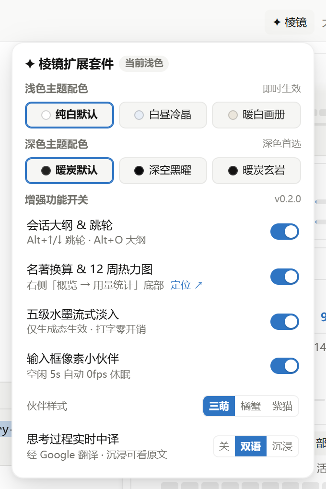

# Anti-Claude Prism Suite

**为 [Anti-Claude](https://github.com/hongqi7/Anti-Claude)（Google Antigravity Desktop）打造的零迟滞、Clean-room 可插拔扩展套件（MIT）**

在不污染 Anti-Claude 原生 `custom.js` / `custom.css` 的前提下，通过独立的 `user/extensions/` 隔离热加载机制，提供 **6 项可独立开关的视觉与效率增强模块**，并内置双上游追踪工具持续伴随演进。

---

## 实机预览

<table>
  <tr>
    <td align="center" width="50%">
      <br />
      <sub>顶栏 <code>✦ 棱镜</code> 控制面板（多套主题 + 6 项独立开关）</sub>
    </td>
    <td align="center" width="50%">
      <br />
      <sub>右侧「用量统计」卡片（14 天柱图 + 名著换算 + 周一对齐 12 周热力图）</sub>
    </td>
  </tr>
  <tr>
    <td align="center" colspan="2">
      <br />
      <sub>输入框顶部三萌像素伙伴（生成弹跳 / 完成庆祝 / 空闲 5s 自动 0fps 休眠）</sub>
    </td>
  </tr>
</table>

---

## 核心特性（v0.2.1）

点击顶栏 **`✦ 棱镜`** 按钮弹出控制面板（动态贴合按钮下方，支持 `Esc` 关闭与窗口缩放自动重定位）：

1. **多套深浅主题配色（随宿主亮暗联动）**
   - 浅色：`纯白默认` / `白昼冷晶`（冷灰蓝 + 钴蓝）/ `暖白画册`（纸张暖白 + 暖棕）
   - 深色：`暖炭默认` / `深空黑曜`（高对比冷黑）/ `暖炭玄岩`（低蓝光暖玄岩）
   - 选非当前亮暗配色时自动记为对应模式首选并给予明确提示。
2. **会话大纲 + `Alt+↑/↓` 实时视口跳轮 + `/btw` 支线提问**
   - 顶栏 **`大纲`**（或 `Alt+O`）打开带实时搜索与当前轮次指示条的大纲抽屉；
   - `Alt+↑/↓` 每次按当前视口阅读位置精准上下跳转，不受手动滚动漂移影响；
   - 悬停行点 `btw` 一键填入输入框（若编辑器受限则自动降级复制到剪贴板）。
3. **用量名著换算 + 周一对齐 12 周热力图**
   - 无侵入融入右侧「概览 → 用量统计」底部（支持面板内 **`定位 ↗`** 一键定位）；
   - 按周一~周日对齐自然周，显示连续活跃天数（Streak）、活跃日均与名著体量换算（点击切换 `今日` / `近12周`）。
4. **零打字迟滞 · 五级水墨流式吐字淡入**
   - 仅在 AI 生成态监听聊天视口 `[data-testid="autoscroll-viewport"]`（与输入框完全隔离，打字 0 回调、0 延迟），生成结束立即断开；
   - 复用 5 个固定 `Highlight` 对象（30fps 限频），颜色通过 `color-mix` 自动适配各主题，尊重 `prefers-reduced-motion`。
5. **输入框上方像素小伙伴（空闲自动 `0fps`）**
   - 原创内联 SVG 像素精灵（`三萌` / `橘蟹` / `紫猫`），空闲 5 秒停动画进入 `0fps` 节能态，窄窗口自动避让。
6. **思考过程实时中文转译**
   - 支持 `关闭` / `双语对照` / `沉浸中文` 三态；流式生成结束后再译避免重复请求，按 ≤ 950 字短分片防长文本超限，折叠自动清理不残留，沉浸模式下每块均支持一键 **`看原文`**。

---

## 安装、卸载与测试

```bash
git clone https://github.com/wushuai0802/anti-claude-prism-suite.git
cd anti-claude-prism-suite

# 安装扩展至 Anti-Claude 的 user/extensions/
node install.mjs

# 卸载（仅清理本套件文件，保留其他扩展）
node uninstall.mjs

# 运行自动化回归测试
npm test
```

---

## 伴随上游双仓更新（Upstream Tracking）

本仓库通过 [upstream.json](./upstream.json) 与 [scripts/check-upstream.mjs](./scripts/check-upstream.mjs) 持续追踪两个上游项目：
- **`hongqi7/Anti-Claude`**：宿主底座（核查热加载接口与 DOM 选择器兼容性）
- **`RMvdesi/obsidian-prism`**：交互灵感参考（严格遵循 Clean-room 原则，绝不直接拷贝 GPL 代码）

随时运行一条命令即可检查双上游是否有新版本，并校验本地 Anti-Claude 底座能力：

```bash
npm run check-upstream
# 或附带检查本地 Anti-Claude 目录接口兼容性：
node scripts/check-upstream.mjs --local-anti-claude "/path/to/Anti-Claude"
```

---

## 免责声明与许可

- 本项目为独立 Clean-room 原创实现，采用 **MIT License** 开源，不隶属于 Google LLC，亦不包含任何第三方 GPL 代码。
