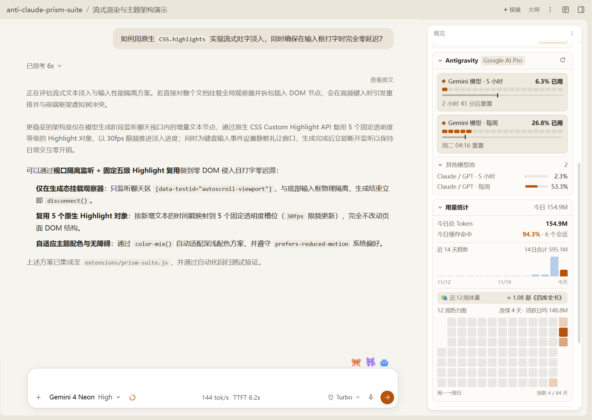
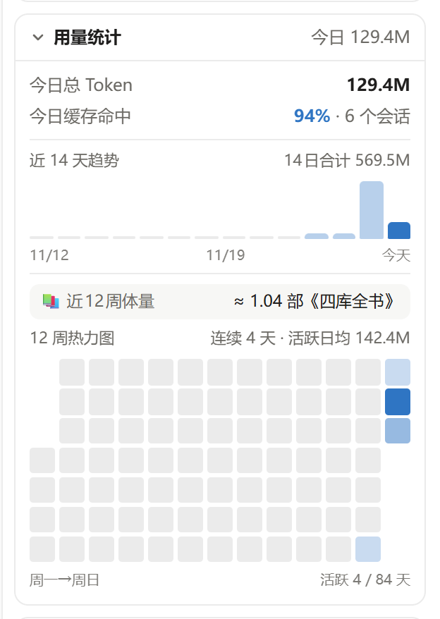
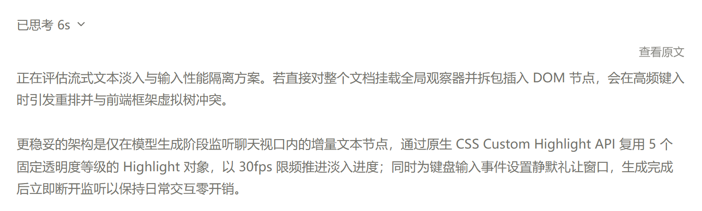

# Anti-Claude Prism Suite

**为 [Anti-Claude](https://github.com/hongqi7/Anti-Claude)（Google Antigravity Desktop）打造的零迟滞、Clean-room 可插拔扩展套件（MIT）**

在不污染 Anti-Claude 原生 `custom.js` / `custom.css` 的前提下，通过独立的 `user/extensions/` 隔离热加载机制，提供 **6 项可独立开关的视觉与效率增强模块**，并内置双上游追踪工具持续伴随演进。

---

## 实机预览

### 整体效果全景

<p align="center">
  <br />
  <sub>主工作区全景：顶栏 <code>✦ 棱镜</code> &amp; <code>大纲</code> 入口 · 对话流沉浸式中文思考块 · 底部像素伙伴与实时指标 · 右侧 14 天趋势图、名著换算与 12 周热力图</sub>
</p>

### 深浅多主题配色

<table>
  <tr>
    <td align="center" width="50%">
      <br />
      <sub>浅色 · <b>暖白画册</b>（纸张暖白 + 暖棕点缀，热力图与配额自动联动）</sub>
    </td>
    <td align="center" width="50%">
      <br />
      <sub>深色 · <b>深空黑曜</b>（纯黑深空高对比，适配长时间沉浸阅读）</sub>
    </td>
  </tr>
</table>

### 核心模块细节

<table>
  <tr>
    <td align="center" width="50%">
      <br />
      <sub>顶栏 <code>✦ 棱镜</code> 控制面板（多套深浅主题 + 6 项独立开关）</sub>
    </td>
    <td align="center" width="50%">
      <br />
      <sub>右侧「用量统计」卡片（14 天柱图 + 名著换算 + 周一对齐 12 周热力图）</sub>
    </td>
  </tr>
  <tr>
    <td align="center" width="50%">
      <br />
      <sub>会话大纲抽屉（<code>Alt+↑/↓</code> 视口跳轮 + 实时搜索 + <code>btw</code> 支线提问）</sub>
    </td>
    <td align="center" width="50%">
      <br />
      <sub>输入框顶部三萌像素伙伴（生成弹跳 / 完成庆祝 / 空闲 5s 自动 <code>0fps</code> 休眠）</sub>
    </td>
  </tr>
  <tr>
    <td align="center" colspan="2">
      <br />
      <sub>思考过程沉浸式中文转译（无框柔灰融入原生流 + 右上角 <code>查看原文</code> 一键对照）</sub>
    </td>
  </tr>
</table>

---

## 核心特性（v0.3.0）

一次部署同时获得 **Anti-Claude 界面增强扩展（6 大模块）** + **Antigravity 原生 MCP App「Prism 文件工作台」**：

### A. 顶栏 `✦ 棱镜` 界面增强套件（Anti-Claude 热加载扩展）

点击顶栏 **`✦ 棱镜`** 按钮弹出控制面板（动态贴合按钮下方，支持 `Esc` 关闭与窗口缩放自动重定位）：

1. **8 套深浅主题配色（2×2 双色色卡，随宿主亮暗联动）**
   - 浅色：`纯白默认` / `白昼冷晶`（冷灰蓝 + 钴蓝）/ `暖白画册`（纸张暖白 + 暖棕）/ `松雾青岚`（雾青底 + 苍松翠绿）
   - 深色：`暖炭默认` / `深空黑曜`（高对比冷黑）/ `暖炭玄岩`（低蓝光暖玄岩）/ `深海墨蓝`（午夜海蓝 + 冰海青蓝）
   - 选非当前亮暗配色时自动记为对应模式首选并给予明确提示。
2. **会话大纲 + `Alt+↑/↓` 实时视口跳轮 + `/btw` 支线提问**
   - 顶栏 **`大纲`**（或 `Alt+O`）打开带实时搜索与当前轮次指示条的大纲抽屉；
   - `Alt+↑/↓` 每次按当前视口阅读位置精准上下跳转，不受手动滚动漂移影响；
   - 悬停行点 `btw` 一键填入输入框（若编辑器受限则自动降级复制到剪贴板）。
3. **用量名著换算 + 周一对齐 12 周热力图**
   - 无侵入融入右侧「概览 → 用量统计」底部（支持面板内 **`定位 ↗`** 一键定位）；
   - 按周一~周日对齐自然周，显示连续活跃天数（Streak）、活跃日均与名著体量换算（点击切换 `今日` / `近12周`）。
4. **零打字迟滞 · 五级水墨流式吐字淡入**
   - 仅在 AI 生成态监听聊天视口 `[data-testid="autoscroll-viewport"]`（与输入框完全隔离，打字 0 回调、0 延迟），生成结束立即断开；
   - 复用 5 个固定 `Highlight` 对象（30fps 限频），颜色通过 `color-mix` 自动适配各主题，尊重 `prefers-reduced-motion`。
5. **输入框上方像素小伙伴（漫游跑跳 + 大小调节 + 跟随蜂群/子 Agent）**
   - 6 种原创内联 SVG 像素精灵（橘蟹 / 紫猫 / 蓝史莱姆 / 绿蛙 / 金雏 / 粉兔），支持 **`固定`**（三萌 / 橘蟹 / 紫猫）与 **`跟随 Agent`**（自动映射 `1 主控 + 存活蜂群/子 Agent`，最多 8 只 + `+N` 徽章，内置 `1~3 只` 保底数量防空屏，且按单个 Agent 运行态独立跑跳）；
   - 新增 **工作态漫游跑跳开关**与**性格档位（温顺 / 活泼）**（低频调度 + 纯 GPU 合成层 `translate3d`，支持小跑、360° 前空翻、翻滚冲刺、二段连跳、开心摇摆、擦肩击掌、摸头 5 连击三连空翻彩蛋、高 TTFT 打盹与首字惊醒、头顶状态微表情 `💡/🔧/💦/zZ`、**随 `tok/s` 自动变速**及**完成集体波浪翻跟头**，闲时 5s 保持纯静态 `0fps` 休眠），以及 **`16px ~ 36px` 无级大小滑块**（实时预览 + 一键复位 `24px`）。
6. **思考过程实时中文转译**
   - 支持 `关闭` / `双语对照` / `沉浸中文` 三态；已完成的思考块展开即译，流式思考结束后再译避免重复请求，按 ≤ 950 字短分片防长文本超限，折叠自动清理不残留，沉浸模式下无框柔灰融入原生流并支持右上角一键 **`查看原文`**。

### B. Prism 文件工作台（原生 Antigravity MCP App 插件，全平台零依赖）

7. **侧边栏 & 全局文件工作台（右侧 `+` → `Prism 文件` / 左侧栏 `Prism 文件`）**
   - **三合一视图**：`目录浏览`（`Ctrl/Cmd+L` 路径直达、实时筛选、隐藏文件切换）+ `最近产物`（自动扫描隐藏的 `~/.gemini/antigravity/brain` 各会话文档与截图）+ `收藏夹`（持久化保存常用目录）；
   - **双栏预览、划词引用与安全原位编辑**：支持代码、Markdown（渲染/源码切换）与图片预览；选中任意片段点 **`引用给 AI`** 直接附加上下文；工作区文本支持带 **SHA-256 乐观锁** 的原位保存（自动禁止读写 `.env` / 密钥 / `.ssh` / `.codex` / `.claude` 等敏感路径，`brain/` 目录严格只读）；
   - **一键原生打开 & 系统目录定位**：支持调用 Antigravity 原生标签页（Monaco / Markdown / Image Viewer）直接打开。
8. **消息流内联文件卡片 + 跨平台双击定位系统目录**
   - 产出交付物时自动在消息流中呈现交互卡片，**双击任意文件（或点「定位」）**直接高亮定位到系统文件管理器：
     - **Windows**：原生 `explorer.exe /select,<path>`
     - **WSL**：自动通过 `wslpath -w` 桥接拉起 Windows 资源管理器（连 WSL 内的 `brain/` 产物都能一键定位！）
     - **macOS**：原生 `open -R`（访达高亮选中）
     - **Linux**：`xdg-open`

---

## 一键安装、卸载与测试

### 方式一：Windows 一键安装器 `.exe`（推荐，双击即用、免命令行）

前往 [**GitHub Releases**](https://github.com/wushuai0802/anti-claude-prism-suite/releases/latest) 下载 **`Anti-Claude-Prism-Suite-Setup.exe`**（纯原生 WinForms，零运行库依赖，约 300KB）：
- 自动识别 Windows Anti-Claude 扩展目录、Windows 插件目录以及 **WSL 发行版内的 Antigravity 插件目录**；
- 勾选需要的模块后点击 **「一键安装 / 更新」** 或 **「干净卸载」** 即可（也可本地运行 `npm run build:win-exe` 自行编译）。

### 方式二：命令行一键安装（Windows / WSL / macOS / Linux 通用）

```bash
git clone https://github.com/wushuai0802/anti-claude-prism-suite.git
cd anti-claude-prism-suite

# 同时安装 Anti-Claude 扩展 + Antigravity Prism 文件工作台插件
node install.mjs

# 仅安装其中一个组件（可选）：
# node install.mjs --extensions-only
# node install.mjs --plugin-only

# 干净卸载（仅清理本套件文件，保留其他扩展与插件）
node uninstall.mjs

# 运行自动化回归测试
npm test
```

---

## 伴随上游双仓更新（Upstream Tracking）

本仓库通过 [upstream.json](./upstream.json) 与 [scripts/check-upstream.mjs](./scripts/check-upstream.mjs) 持续追踪两个上游项目：
- **`hongqi7/Anti-Claude`**：宿主底座（核查热加载接口与 DOM 选择器兼容性）
- **`RMvdesi/obsidian-prism`**：交互灵感参考（严格遵循 Clean-room 原则，绝不直接拷贝 GPL 代码）

随时运行一条命令即可检查双上游是否有新版本，并校验本地 Anti-Claude 底座能力：

```bash
npm run check-upstream
# 或附带检查本地 Anti-Claude 目录接口兼容性：
node scripts/check-upstream.mjs --local-anti-claude "/path/to/Anti-Claude"
```

---

## 免责声明与许可

- 本项目为独立 Clean-room 原创实现，采用 **MIT License** 开源，不隶属于 Google LLC，亦不包含任何第三方 GPL 代码。
