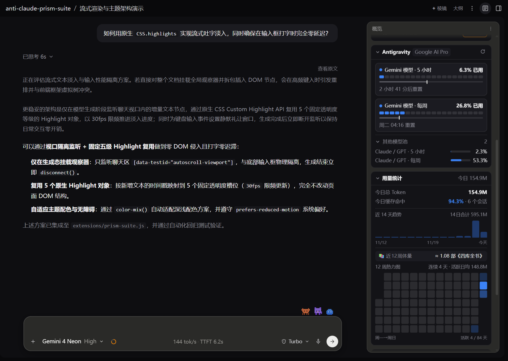

# Anti-Claude Prism Suite

**为 [Anti-Claude](https://github.com/hongqi7/Anti-Claude)（Google Antigravity Desktop）打造的零迟滞、Clean-room 可插拔扩展套件（MIT）**

在不污染 Anti-Claude 原生 `custom.js` / `custom.css` 的前提下，通过独立的 `user/extensions/` 隔离热加载机制，提供 **6 项可独立开关的视觉与效率增强模块**，并内置双上游追踪工具持续伴随演进。

---

## 实机预览

### 整体效果全景

<p align="center">
  <br />
  <sub>主工作区全景：顶栏 <code>✦ 棱镜</code> &amp; <code>大纲</code> 入口 · 对话流沉浸式中文思考块 · 底部像素伙伴与实时指标 · 右侧 14 天趋势图、名著换算与 12 周热力图</sub>
</p>

### 深浅多主题配色

<table>
  <tr>
    <td align="center" width="50%">
      <br />
      <sub>浅色 · <b>暖白画册</b>（纸张暖白 + 暖棕点缀，热力图与配额自动联动）</sub>
    </td>
    <td align="center" width="50%">
      <br />
      <sub>深色 · <b>深空黑曜</b>（纯黑深空高对比，适配长时间沉浸阅读）</sub>
    </td>
  </tr>
</table>

### 核心模块细节

<table>
  <tr>
    <td align="center" width="50%">
      <br />
      <sub>顶栏 <code>✦ 棱镜</code> 控制面板（多套深浅主题 + 6 项独立开关）</sub>
    </td>
    <td align="center" width="50%">
      <br />
      <sub>右侧「用量统计」卡片（14 天柱图 + 名著换算 + 周一对齐 12 周热力图）</sub>
    </td>
  </tr>
  <tr>
    <td align="center" width="50%">
      <br />
      <sub>会话大纲抽屉（<code>Alt+↑/↓</code> 视口跳轮 + 实时搜索 + <code>btw</code> 支线提问）</sub>
    </td>
    <td align="center" width="50%">
      <br />
      <sub>输入框顶部三萌像素伙伴（生成弹跳 / 完成庆祝 / 空闲 5s 自动 <code>0fps</code> 休眠）</sub>
    </td>
  </tr>
  <tr>
    <td align="center" colspan="2">
      <br />
      <sub>思考过程沉浸式中文转译（无框柔灰融入原生流 + 右上角 <code>查看原文</code> 一键对照）</sub>
    </td>
  </tr>
</table>

---

## 核心特性（v0.5.0）

一次部署同时获得 **Anti-Claude 模块化界面增强扩展（3 组 6 文件，零全局 body 观察器）** + **Antigravity 原生 MCP App「Prism 文件工作台」**（含主备账号接力、零依赖槽位交接记忆与上游更新雷达）：

### A. 顶栏 `✦ 棱镜` 界面增强套件（Anti-Claude 热加载扩展）

点击顶栏 **`✦ 棱镜`** 按钮弹出控制面板（动态贴合按钮下方，支持 `Esc` 关闭与窗口缩放自动重定位）：

1. **8 套深浅主题配色（2×2 双色色卡，随宿主亮暗联动）**
   - 浅色：`纯白默认` / `白昼冷晶`（冷灰蓝 + 钴蓝）/ `暖白画册`（纸张暖白 + 暖棕）/ `松雾青岚`（雾青底 + 苍松翠绿）
   - 深色：`暖炭默认` / `深空黑曜`（高对比冷黑）/ `暖炭玄岩`（低蓝光暖玄岩）/ `深海墨蓝`（午夜海蓝 + 冰海青蓝）
   - 选非当前亮暗配色时自动记为对应模式首选并给予明确提示。
2. **会话大纲 + `Alt+↑/↓` 实时视口跳轮 + `/btw` 支线提问**
   - 顶栏 **`大纲`**（或 `Alt+O`）打开带实时搜索与当前轮次指示条的大纲抽屉；
   - `Alt+↑/↓` 每次按当前视口阅读位置精准上下跳转，不受手动滚动漂移影响；
   - 悬停行点 `btw` 一键填入输入框（若编辑器受限则自动降级复制到剪贴板）。
3. **用量名著换算 + 周一对齐 12 周热力图**
   - 无侵入融入右侧「概览 → 用量统计」底部（支持面板内 **`定位 ↗`** 一键定位）；
   - 按周一~周日对齐自然周，显示连续活跃天数（Streak）、活跃日均与名著体量换算（点击切换 `今日` / `近12周`）。
4. **零打字迟滞 · 五级水墨流式吐字淡入**
   - 仅在 AI 生成态监听聊天视口 `[data-testid="autoscroll-viewport"]`（与输入框完全隔离，打字 0 回调、0 延迟），生成结束立即断开；
   - 复用 5 个固定 `Highlight` 对象（30fps 限频），颜色通过 `color-mix` 自动适配各主题，尊重 `prefers-reduced-motion`。
5. **输入框上方像素小伙伴（漫游跑跳 + 大小调节 + 跟随蜂群/子 Agent）**
   - 6 种原创内联 SVG 像素精灵（橘蟹 / 紫猫 / 蓝史莱姆 / 绿蛙 / 金雏 / 粉兔），支持 **`固定`**（三萌 / 橘蟹 / 紫猫）与 **`跟随 Agent`**（自动映射 `1 主控 + 存活蜂群/子 Agent`，最多 8 只 + `+N` 徽章，内置 `1~3 只` 保底数量防空屏，且按单个 Agent 运行态独立跑跳）；
   - 新增 **工作态漫游跑跳开关**与**性格档位（温顺 / 活泼）**（低频调度 + 纯 GPU 合成层 `translate3d`，支持小跑、360° 前空翻、翻滚冲刺、二段连跳、开心摇摆、擦肩击掌、摸头 5 连击三连空翻彩蛋、高 TTFT 打盹与首字惊醒、头顶状态微表情 `💡/🔧/💦/zZ`、**随 `tok/s` 自动变速**及**完成集体波浪翻跟头**，闲时 5s 保持纯静态 `0fps` 休眠），以及 **`16px ~ 36px` 无级大小滑块**（实时预览 + 一键复位 `24px`）。
6. **思考过程实时中文转译**
   - 支持 `关闭` / `双语对照` / `沉浸中文` 三态；已完成的思考块展开即译，流式思考结束后再译避免重复请求，按 ≤ 950 字短分片防长文本超限，折叠自动清理不残留，沉浸模式下无框柔灰融入原生流并支持右上角一键 **`查看原文`**。
7. **视觉特效、排版与侧栏细节（`prism-suite-fx`，可选独立开关）**
   - **工作时输入框流光边框（Border Beam）**与**输入框额度光环**：单 `rAF` 调度器、空闲 `0fps` 停帧，6 套流光配色自动联动当前棱镜主题色，工作时与额度光环自动交叉互斥；
   - **ThinkingOrb 3D 粒子进度球**：128 颗极简粒子随思考/工具/生成/完成平滑形变，可与像素萌宠共存或切换；
   - **用户气泡着色滑条（10%–100%）**、**紧凑排版**、**后台完成标题 `(N)` 未读数**、项目默认展示条数、切会话保持概览展开、常驻轮次目录、主题自适应 Tooltip 与面板内 GitHub 新版检查。
8. **高效微交互、2.35/Swarm 增量多语言与会话分支（`prism-suite-workflow`）**
   - **对话图片右键三连**（引用到输入框 / 复制 PNG / 保存）、**回复复制自动过滤折叠摘要**、**SSH 粘贴自动提取 `user@host:port` 并丢弃密码**；
   - **简 / 繁 / 英增量词条补全**（覆盖 2.34–2.35 与 Swarm 面板，切回无损还原）、**原位消息编辑快捷补位**与**任意轮次分支新会话**（含零依赖回环 CDP 脚本 `scripts/fork-session.mjs`）。

### B. Prism 文件工作台（原生 Antigravity MCP App 插件，全平台零依赖）

9. **侧边栏 & 全局五合一文件与接力工作台（顶栏 `工作台` 一键分屏直达 / `✦ 棱镜` 账号胶囊 `⚡ 切号` 直达）**
   - **五合一视图 + 页签记忆**：`目录浏览`（可点击路径面包屑 + `Ctrl/Cmd+L` 路径直达、未截断目录 `0ms` 本地过滤与中文输入法防抖、`↑/↓/Enter/Backspace` 纯键盘导航、隐藏文件切换、可选私网 `NAS/SMB` 安全校验）+ `最近产物`（自动扫描 `~/.gemini/antigravity/brain` 文档与截图）+ `收藏夹` + **`历史检索`**（跨历史会话脱敏全文检索正文/代码块/终端命令）+ **`账号接力`**（默认关闭，含主备账号、槽位记忆与上游雷达）；自动记忆上次停留页签；
   - **双栏预览、全文复制、行号区间引用与安全原位编辑**：支持代码、Markdown（渲染/源码切换）与图片预览；新增「一键复制全文」以及**点击行号 / `Shift+点击` 选中行区间生成 `@path#L10-L25` 精确引用给 AI**（或划词引用）；工作区文本支持带 **SHA-256 乐观锁** 的原位保存（自动禁止读写 `.env` / 密钥 / `.ssh` / `.codex` / `.claude` / 凭据文件，`brain/` 目录严格只读）；
   - **「打开方式 ▾」动态外部编辑器/终端菜单**：自动探测本机 VS Code / Cursor / Windsurf / Antigravity / Zed / JetBrains / Windows Terminal / Git Bash（带 60s 缓存）并支持 `#L:C` 行列号直达。
10. **主备多账号半自动倒计时接力 + 切后自动安全重启 + 实时额度桥接（`prism_memory_*` & `prism_quota_sync`）**
    - **物理隔离 · 100% 保留本地会话**：默认关闭、显式确认开启；仅在 OS 原生凭据库隔离命名空间内校验切换 OAuth 凭据（单次 PowerShell 批量事务 + `0ms` 脱敏元数据缓存 + 强校验 `id_token_email` 防串号 + 未捕获新号切走前自动建槽防丢 + 异常自动回滚 + 跨进程 `switch.lock`），**绝不修改本地对话 SQLite、`brain/` 与工作区**；
    - **切号后自动安全重启 Antigravity（保留扩展挂载）**：脱离 WSL/MCP 进程树经 Explorer COM / WMI 安全优雅关闭并重开 Antigravity，自动探测并保留 `--remote-debugging-port=0` 参数与反误杀 PID 快照，重启后底部回跳条一键返回原会话；
    - **实时额度自动桥接 + `✦ 棱镜` 账号胶囊**：主界面观测到的 5h / 7d 实时额度与重置时间自动脱敏同步至「账号接力」卡片（免手填 + 离线回血推算），`✦ 棱镜` 弹窗顶部常驻当前账号与额度胶囊并支持一键 `⚡ 切号` 直达；
    - **零依赖槽位交接记忆 + 外部 `memory-mcp` 联动桥**：提供 `prism_memory_store` / `prism_memory_list` / `prism_memory_search` 三个轻量工具，按 `handoff:<project>:<slot>` 严格时间倒序精确拉取（自动脱敏私钥 / API Key / JWT），并支持一键复制外部 `memory_store` 同步指令；随仓提供通用规则模板 [templates/multi-account-handoff.rule.md](./templates/multi-account-handoff.rule.md)。
11. **消息流内联文件卡片 + 全平台防空格双击定位系统目录**
   - 产出交付物时自动在消息流中呈现交互卡片，**双击任意文件（或点「定位」/「打开方式 ▾」）**直接高亮定位到系统文件管理器（完美兼容 Windows 含空格/逗号/Unicode 路径与盘符根目录）：
     - **Windows**：原生 `explorer.exe /select,<path>`
     - **WSL**：自动通过 `wslpath -w` 桥接拉起 Windows 资源管理器（连 WSL 内的 `brain/` 产物都能一键定位！）
     - **macOS**：原生 `open -R`（访达高亮选中）
     - **Linux**：`xdg-open`

---

## 一键安装、卸载、账号接力与测试

### 方式一：Windows 一键安装器 `.exe`（推荐，双击即用、免命令行）

前往 [**GitHub Releases**](https://github.com/wushuai0802/anti-claude-prism-suite/releases/latest) 下载 **`Anti-Claude-Prism-Suite-Setup.exe`**（纯原生 WinForms，零运行库依赖）：
- 自动识别 Windows Anti-Claude 扩展目录、Windows 插件目录以及 **WSL 发行版内的 Antigravity 插件目录**；
- 采用**原地增量更新保留根目录 inode**（与 `install.mjs` 一致，热更新绝不破坏驻留 MCP 进程工作目录），并附带 `--remote-debugging-port=0` 快捷方式只读自检；
- 勾选需要的模块后点击 **「一键安装 / 更新」** 或 **「干净卸载」** 即可（也可本地运行 `npm run build:win-exe` 自行编译）。

### 方式二：命令行一键安装（Windows / WSL / macOS / Linux 通用）

```bash
git clone https://github.com/wushuai0802/anti-claude-prism-suite.git
cd anti-claude-prism-suite

# 同时安装 Anti-Claude 扩展 + Antigravity Prism 文件工作台插件
node install.mjs

# 仅安装其中一个组件（可选）：
# node install.mjs --extensions-only
# node install.mjs --plugin-only

# 干净卸载（仅清理本套件文件，保留其他扩展与插件）
node uninstall.mjs

# 运行自动化回归测试
npm test

# 主备账号接力 CLI（默认关闭，需先 enable；零明文输出）
npm run accounts -- --help
```

---

## 上游更新雷达（Upstream Radar · 择优吸收，绝不照搬照抄）

本仓库通过 [upstream.json](./upstream.json)、[scripts/check-upstream.mjs](./scripts/check-upstream.mjs) 与每周自动巡检工作流 [.github/workflows/upstream-watch.yml](./.github/workflows/upstream-watch.yml) 持续追踪 4 个关联上游：
- **`hongqi7/Anti-Claude`**（MIT · `host-runtime`）：追踪宿主扩展接口与 DOM 兼容性变更
- **`WhiteBr1ck/agy-powertools`**（MIT · `feature-reference`）：追踪凭据库路径变动与实用/有趣功能创意
- **`RMvdesi/obsidian-prism`**（GPL-3.0 · `inspiration-only`）：严格遵守 Clean-Room 原则，仅提取交互灵感、绝不移植 GPL 源码
- **`anglee0323/agy-switch`**（MIT · `ecosystem-watch`）：追踪认证生态底层变化信号

> **筛选原则**：只提取对本项目真正有帮助的兼容性修复与新增实用/有趣功能作为**候选清单**交由用户拍板融合，严禁照搬照抄全盘代码。

```bash
# 按需对比基线并输出三分类择优候选报告
npm run check-upstream -- --markdown

# 评估确认融合完毕后同步基线：
# node scripts/check-upstream.mjs --sync-baseline
```

---

## 免责声明与许可

- 本项目为独立 Clean-room 原创实现，采用 **MIT License** 开源，不隶属于 Google LLC，亦不包含任何第三方 GPL 代码。
